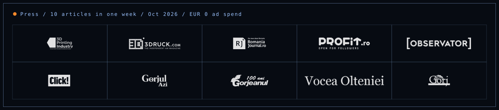

<picture>
  <source media="(max-width: 600px)" srcset="assets/header-m.svg">
  
</picture>

**Head of AI & Automation.** Takes AI systems for finance and accounting from first commit to production, then runs them, with the controls a regulator and a finance director expect. Built an Irish chartered accountancy firm's AI service line from zero. Led a regulated FinTech through its EU licence audit as COO. Founded 3Descu and grew it from five 3D printers in an apartment to a 200+ 3D printer factory; co-founder of Systemartis, an AI systems studio. Clients and customers in 32+ countries on four continents.

**[adriancapraru.com](https://adriancapraru.com)** &nbsp;/&nbsp; [CV (PDF)](https://adriancapraru.com/cv.pdf) &nbsp;/&nbsp; [LinkedIn](https://www.linkedin.com/in/adriancapraru27) &nbsp;/&nbsp; [Upwork](https://www.upwork.com/freelancers/cadrian)

 

## Built and running in production

Five systems, each drawn the way it runs. Dashed frame: outside the system. Double frame: a person or a hard check. Orange: live in production. Client names are withheld; the long-form write-ups are in [production-case-studies](https://github.com/cadi27tech/production-case-studies) and on [the site](https://adriancapraru.com/work/).

### 01 &nbsp;/&nbsp; An accountancy firm's client platform, live in 10 days

An Irish chartered accountancy and audit firm offered no AI. Adrian built its AI & Automation service line and runs it, including a 20-module client platform: bills and receipts, VAT, supplier payments, credit control, Irish tax deadlines, proposals. EU-only AI processing is enforced in code, and an AML gate keeps a client account blocked until identity is verified.

- **10 days** from first commit (23 Sep 2026) to live production (3 Oct 2026); **20 modules** within four weeks
- **3,000+** automated checks green (3,230 with 0 failures on 17 Oct), and an **87-point** smoke test on every deploy
- **99.8%** field accuracy of the AI bills reader on a 64-file synthetic test corpus, at **under 1 cent** per document

<picture>
  <source media="(max-width: 600px)" srcset="assets/sys-accountancy-m.svg">
  
</picture>

TypeScript, Vercel (Dublin), Supabase eu-west-1 with row-level security, Gemini via Vertex AI EU, Xero API, VIES, SEPA pain.001 &nbsp;/&nbsp; [Case study](https://adriancapraru.com/work/accountancy-saas-live-in-10-days/) &nbsp;/&nbsp; [60 s film](https://adriancapraru.com/work/accountancy-saas-live-in-10-days/#film)

### 02 &nbsp;/&nbsp; HubSpot to Xero across 3 legal entities

Closed deals become approved Xero invoices in the right legal entity (US, UK or EU) and currency, emailed to the customer and chased until paid. Delivered for a multi-entity B2B software reseller.

- Live since **15 Apr 2026**: **212+** invoices processed by September, about 52 a month, under signed approvals
- **8** n8n workflows, **119** nodes; HMAC-signed finance approvals; idempotency keys and a dead-letter queue, so a retry never doubles an invoice
- Pre-launch audit: **9** bugs fixed (2 critical) and **18** edge cases covered; a 49-assertion test harness shipped with the September hardening release

<picture>
  <source media="(max-width: 600px)" srcset="assets/sys-hubspot-xero-m.svg">
  
</picture>

n8n, HubSpot API, Xero API (3 tenants, OAuth2), Supabase, HMAC webhooks &nbsp;/&nbsp; [Case study](https://adriancapraru.com/work/hubspot-to-xero-multi-entity-invoicing/) &nbsp;/&nbsp; [60 s film](https://adriancapraru.com/work/hubspot-to-xero-multi-entity-invoicing/#film)

### 03 &nbsp;/&nbsp; Xero prepayment journals, 107 of 107

Supplier bills for an Irish tour operator are read, coded and moved from prepayments to expense by arrival month, as draft journals the bookkeeper approves. Nothing posts without the bookkeeper.

- **107 of 107** match against the bookkeeper's own entries before go-live
- **271** bills scanned in a live dry run with writes disabled; nothing changed
- **10 of 10** daily production runs green in the first ten days (live since 16 Oct 2026)

<picture>
  <source media="(max-width: 600px)" srcset="assets/sys-prepayments-m.svg">
  
</picture>

Python 3.12, Xero Accounting API (OAuth2), GitHub Actions &nbsp;/&nbsp; [Case study](https://adriancapraru.com/work/xero-prepayment-journals-automation/)

### 04 &nbsp;/&nbsp; 3Descu: a factory platform, and an MCP server in the official registry

Founded in 2022 with an EU start-up grant and five 3D printers in an apartment. Today 200+ 3D printers, an ISO 9001:2015 certified company, buyers in 26 of the 27 EU member states. Adrian wrote all of its software alone, directing AI coding agents behind tests and review gates.

- Quoting-to-fulfilment platform in 4 languages: **929** commits and **~400** merged pull requests in under five months, **38** edge functions
- Release gate of **120+** checkers running about **260K** assertions, with mutation-tested guards
- One of the first manufacturing MCP servers, in the [official MCP Registry](https://registry.modelcontextprotocol.io/v0/servers?search=3descu) as `io.github.cadi27tech/3descu-quote` since 18 Oct 2026: 4 read-only tools, keyless, rate-limited ([write-up](https://github.com/cadi27tech/3descu-mcp-quote))
- Turnover **x65** in three years at a **57%** net margin, with no outside equity (public filings)

<picture>
  <source media="(max-width: 600px)" srcset="assets/sys-3descu-m.svg">
  
</picture>

React, TypeScript, Supabase (Postgres, Edge Functions), Stripe, Model Context Protocol, GitHub Actions &nbsp;/&nbsp; [quote.3descu.com](https://quote.3descu.com) &nbsp;/&nbsp; [Case study](https://adriancapraru.com/work/3d-printing-factory-platform-mcp-server/) &nbsp;/&nbsp; [60 s film](https://adriancapraru.com/work/3d-printing-factory-platform-mcp-server/#film)

### 05 &nbsp;/&nbsp; An EU crowdfunding licence, as COO

Three years as COO of HighCrowd, a real-estate crowdfunding platform for retail investors, and lead on the authorisation and audit with the ASF, Romania's financial regulator.

- ECSP licence granted in **March 2024**: Romania's **4th**, and the **2nd** for real estate ([ASF register](https://data.asfromania.ro/registru/lista.php?sect=5801&lng=1))
- KYC and AML onboarding automated under PSD2: about **45 to 8 minutes** per investor (internal measure)
- The investor-protection flows ECSP requires: entry knowledge test, loss-bearing simulation, key investment information sheets, reflection period

<picture>
  <source media="(max-width: 600px)" srcset="assets/sys-ecsp-m.svg">
  
</picture>

ECSP, Regulation (EU) 2020/1503, KYC and AML, PSD2, penetration testing, policy set &nbsp;/&nbsp; [Case study](https://adriancapraru.com/work/eu-crowdfunding-licence-asf-authorisation/)

**Also in production:** an [EU-sovereign financial reporting platform](https://adriancapraru.com/work/eu-sovereign-financial-reporting-platform/) for the Dutch education sector, with no US-owned service in the stack, 52 of 52 sign-in end-to-end tests and 5 of 5 row-level security policies caught when deliberately broken; and [daily revenue reporting for a 5-hotel group](https://adriancapraru.com/work/hotel-group-daily-revenue-reporting/), matched to the accountants' own figures cell by cell for every hotel.

 

## Open source

| Repository | What it is |
|---|---|
| [3descu-mcp-quote](https://github.com/cadi27tech/3descu-mcp-quote) | Case study and connection guide for the public 3Descu MCP server: real factory quotes inside Claude and ChatGPT. A daily smoke test runs against the live endpoint. |
| [adrian-capraru-mcp](https://github.com/cadi27tech/adrian-capraru-mcp) | An agent-readable profile: six read-only MCP tools so Claude, ChatGPT or Cursor can read his roles, case studies, published prices and availability, and return the routes to hire him. Generated from the site data; sends nothing. |
| [ai-agent-guardrails](https://github.com/cadi27tech/ai-agent-guardrails) | Claude Code hooks written after real incidents with AI coding agents. A guard that cannot read its input fails loud. |
| [3descu-social-agent](https://github.com/cadi27tech/3descu-social-agent) | EUR 0 a month calendar publisher on GitHub Actions and the Meta Graph API. Idempotent, on time, never backfills a missed post. |
| [blueprint-svg](https://github.com/cadi27tech/blueprint-svg) | The drawing kit behind every diagram on this page: one spec, a wide and a phone layout, renders inside an ``. |
| [production-case-studies](https://github.com/cadi27tech/production-case-studies) | Seven production systems written up long form, with system drawings. No client code. |
| [adriancapraru.com](https://github.com/cadi27tech/cadi27tech.github.io) | The personal site: a static build from one content file, a motion layer, Playwright QA at desktop and phone widths. |
| [real-estate-ai-analyzer](https://github.com/cadi27tech/real-estate-ai-analyzer) | Streamlit investment analyzer from 2025: tested deterministic finance module, LLM market notes ([live demo](https://real-estate-ai-analyzer.streamlit.app/)). |

**Merged upstream:** [punkpeye/awesome-remote-mcp-servers #2201](https://github.com/punkpeye/awesome-remote-mcp-servers/pull/2201), [TensorBlock/awesome-mcp-servers #4125](https://github.com/TensorBlock/awesome-mcp-servers/pull/4125), [mcpHQ/awesome-mcp-servers #325](https://github.com/mcpHQ/awesome-mcp-servers/pull/325), [toolsdk-ai/toolsdk-mcp-registry #930](https://github.com/toolsdk-ai/toolsdk-mcp-registry/pull/930).
In review: [docker/mcp-registry #5852](https://github.com/docker/mcp-registry/pull/5852), [jaw9c/awesome-remote-mcp-servers #1469](https://github.com/jaw9c/awesome-remote-mcp-servers/pull/1469), [sylviangth/awesome-remote-mcp-servers #216](https://github.com/sylviangth/awesome-remote-mcp-servers/pull/216), [ravitemer/mcp-registry #79](https://github.com/ravitemer/mcp-registry/pull/79).

 

## How the work runs

- **Numbers computed, words generated.** Figures come from deterministic code; AI writes the words around them. A fee, a VAT amount or a filing deadline is never a model guess.
- **People approve what needs judgement.** Agents act; people sign off wherever money, customers or a client ledger are involved. Drafts, not postings.
- **Evals and regression gates.** Golden test sets, mutation-tested guards, deploy smoke tests, and the client's own numbers as the acceptance test.
- **A trail an auditor can follow.** Every action is logged and idempotent, so a retry never doubles an invoice. Failed jobs land in a queue a person reviews, never in silence.
- **AI coding agents under review.** Parallel agents in git worktrees, hooks that turn claims into evidence, and a human merging every pull request.
- **Built to hand over.** Code, data, accounts and runbooks sit with the client from day one.

## Stack

| Area | Tools |
|---|---|
| AI and agents | Claude, Gemini via Vertex AI (EU), Model Context Protocol, tool registries, confirm-first assistants, golden test sets |
| Languages and apps | TypeScript, Python, React, Next.js, Deno |
| Data and infrastructure | Supabase and PostgreSQL with row-level security, Vercel, Google Cloud Run, Docker Compose, Caddy, GitHub Actions |
| Automation | n8n (cloud and self-hosted), HMAC-signed webhooks, idempotency keys, dead-letter queues |
| Finance systems | Xero, HubSpot, Exact Online, SEPA pain.001, VIES, e-Factura, Stripe |
| Identity and compliance | Microsoft Entra ID, KYC and AML under PSD2, GDPR retention, EU data residency in code |

## What clients said

> Adrian is a total pro. Just looking at his CV you can tell he's not the average freelancer on here, and the work really proved it. The automation runs perfectly...
>
> Nicolas P., workflow set-up, Upwork

> The Prompt Optimizer workflow is solid... It's now perfectly modular... Clean, professional, and future-proof.
>
> Danish industrial-automation team, self-improving LLM pipeline for PLC code, Upwork (five stars and a bonus)

> Capraru was extremely knowledgable in N8N, AI and general automation. He put together an excellent workflow that helped us achieve human scoring, automated content.
>
> UK internet-marketing firm, AI workflow automation, Upwork

Top Rated on Upwork with 100% Job Success: 22 contracts, 12 of 12 rated contracts five stars, one client hired four times.

## Press

<picture>
  <source media="(max-width: 600px)" srcset="assets/press-m.svg">
  
</picture>

[3D Printing Industry](https://3dprintingindustry.com/news/3descu-enables-3d-printing-quotes-through-chatgpt-and-claude-255887/): 3Descu enables 3D printing quotes through ChatGPT and Claude &nbsp;/&nbsp; [3Druck.com](https://3druck.com/en/programs/3descu-integrates-ki-based-pricing-calculations-for-3d-printing-into-chatgpt-and-claude-02164231/) &nbsp;/&nbsp; [Romania Journal](https://www.romaniajournal.ro/business/companies/romanian-factory-3descu-opens-its-3d-printing-quotes-to-ai-assistants/) &nbsp;/&nbsp; [Profit.ro](https://www.profit.ro/povesti-cu-profit/foto-fabrica-pornita-intr-un-apartament-cu-5-imprimante-de-un-tanar-intors-acasa-a-ajuns-la-afaceri-de-circa-1-milion-lei-toata-lumea-se-astepta-sa-plec-22863423) &nbsp;/&nbsp; [Observator News](https://observatornews.ro/economic/afacerea-pornita-de-la-zero-de-un-tanar-din-gorj-intrun-apartament-a-ajuns-la-aproape-un-milion-de-lei-669802.html) &nbsp;/&nbsp; [all ten](https://adriancapraru.com/press/)

## Contact

**[adriancapraru.com](https://adriancapraru.com)** &nbsp;/&nbsp; [CV (PDF)](https://adriancapraru.com/cv.pdf) &nbsp;/&nbsp; [LinkedIn](https://www.linkedin.com/in/adriancapraru27) &nbsp;/&nbsp; [Upwork](https://www.upwork.com/freelancers/cadrian)

Every drawing on this page is generated with [blueprint-svg](https://github.com/cadi27tech/blueprint-svg). Every figure is sourced on the linked case study.
